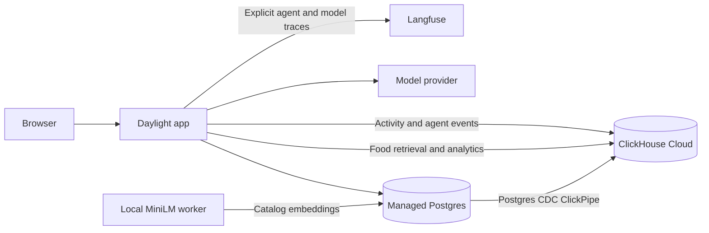

# Daylight: an AI-native fitness tracker demo

Daylight is a fitness and food journal that demonstrates how an AI application
uses Postgres, ClickHouse, and Langfuse together. Search a food directly or describe
a meal in chat, review its portions, and log it. Ask questions about activity and
nutrition, then inspect the SQL tools and model calls behind the answer.

The demo includes public USDA food catalogs and synthetic activity. No personal
health records or service credentials are included.

## What it demonstrates

- **Hybrid food retrieval:** 384-dimensional MiniLM embeddings combined with
  lexical matching and structured filters in ClickHouse.
- **Transactional application data:** Postgres stores the catalog, meal drafts,
  confirmed meals, and food-source metadata.
- **Real CDC:** a Postgres ClickPipe replicates catalog embeddings and meal
  inserts, updates, and deletes into ClickHouse Cloud.
- **Activity analytics:** synthetic wearable events feed a daily activity
  materialized view, while mutable meal totals use current-version CDC views.
- **An agent using database tools:** live model calls search foods, query history,
  and prepare editable meal drafts. Saving a meal requires confirmation in the UI.
- **Inspectable traces:** Langfuse captures model and tool inputs/outputs, token
  usage, available reasoning summaries, and multi-turn conversation sessions.

## Architecture



The app and embedding worker run on your laptop. The Cloud databases and ClickPipe
run independently. Embeddings require no external embedding-provider API key.

## Set up your Cloud environment

Follow [HANDOFF.md](HANDOFF.md) for provisioning, credentials, networking, CDC
mapping, data loading, and live verification. To delegate setup, point a coding
agent at [AGENTS.md](AGENTS.md); it includes provisioning and acceptance checks.

You configure:

| Component | Required settings |
| --- | --- |
| Managed Postgres | Direct connection string and TLS CA certificate |
| ClickHouse Cloud | HTTPS host, port, username, password |
| Postgres CDC ClickPipe | `public.foods` → `default.foods_cdc`; `public.meals` → `default.meals_cdc` |
| Model provider | API endpoint, model name, API key, supported API style |
| Langfuse | Instance URL and project public/secret keys |

Clone the repository and copy the configuration template:

```bash
git clone https://github.com/jnatkins/fitness-tracker-demo.git
cd fitness-tracker-demo
cp .env.example .env
```

Edit `.env` using your own endpoints and credential-manager references. The
example uses 1Password references; live secrets stay in your credential manager.
`.env` is ignored and is not loaded automatically. With `uv` and the 1Password
CLI installed, run:

```bash
op run --env-file=.env -- ./scripts/sa-demo init
# Configure the CDC ClickPipe as described in HANDOFF.md, then:
op run --env-file=.env -- ./scripts/sa-demo views
op run --env-file=.env -- ./scripts/sa-demo load-data
op run --env-file=.env -- ./scripts/sa-demo check
op run --env-file=.env -- ./scripts/sa-demo start
```

Open <http://127.0.0.1:8088>. Another credential resolver can export equivalent
variables and invoke `scripts/sa-demo` directly. These commands prepare schemas
and data; provisioning the services and ClickPipe is a separate setup step.

## Try it locally

With Docker Desktop or OrbStack and `uv` installed:

```bash
./scripts/start-team --catalog
```

The first run downloads the embedding model and USDA catalogs, starts local
Postgres/ClickHouse, and loads sample data. Later runs can omit `--catalog`.
The default local mode uses guided rehearsal without model calls or trace uploads.
To enable a live model and Langfuse, resolve your own configuration into the
launch environment and run `./scripts/start-team --live`.

Local replication uses a transactional outbox, **not** a managed CDC ClickPipe.
The local embedding path uses ClickHouse SQL `aiEmbed` backed by the app's local
embedding endpoint. Native Linux Docker has not been verified.

Keep the app terminal open; Ctrl-C stops the app. Local Docker volumes and Cloud
services retain data. On macOS, `caffeinate -i` can keep the laptop awake.

## Load data and explore

`sa-demo load-data` performs the Cloud data load:

| Dataset | Loaded into |
| --- | --- |
| USDA SR Legacy and FNDDS food catalogs, nutrients, and household portions | Postgres, then ClickHouse through CDC |
| Catalog embeddings and matching text/model metadata | Postgres, then ClickHouse through CDC |
| Illustrative foods and sample meals | Postgres, then ClickHouse through CDC |
| Synthetic activity across 250 users and 28 days | ClickHouse activity table and daily materialized view |

Downloaded public archives and reports stay in `.demo/usda`. First-time catalog
embedding takes time. The loader waits for CDC catch-up; if that wait times out,
inspect the ClickPipe and rerun `sa-demo check`.

Try this walkthrough:

1. Search for jelly manually, select a food, and adjust its portion.
2. Tell the live agent “I had a peanut butter and jelly sandwich for lunch.”
   Review the draft, confirm it, and inspect the tool calls.
3. Ask “Compare my steps today with my usual training days,” then follow up.
4. Open **Under the hood** and generate activity to show the daily rollup.
5. Add the provided skyr example while the Cloud app is running:
   `op run --env-file=.env -- uv run python scripts/catalog-change.py`.
   Search for skyr after embedding enrichment and CDC finish.
6. In Langfuse, inspect the conversation session, model inputs/outputs, usage,
   and tool observations nested under the generation that requested them.

## Tracing and data boundaries

Langfuse is optional. Set `LANGFUSE_BASE_URL`, `LANGFUSE_PUBLIC_KEY`, and
`LANGFUSE_SECRET_KEY` to configure it; set `LANGFUSE_TRACING_ENABLED=false` to
explicitly disable it. Unconfigured tracing does not upload data. Partial
configuration fails startup.

Model request/response payloads and tool results are captured at their execution
boundaries. Provider reasoning summaries are retained when available; opaque
encrypted reasoning state is excluded. Credentials, HTTP headers, mutable runtime
objects, and raw exception bodies are excluded. Shutdown flushes pending traces.
Configuration status alone does not prove remote delivery—verify a real trace.

Prompts and tool results go to your chosen model provider and Langfuse project.
Use the supplied sample data. Personal profiles require authorization for those
destinations before enabling personal-data tracing. This app is a single-user
laptop demo, without public hosting or multi-user authentication.

## Development and verification

For focused tests that do not require databases:

```bash
uv sync --locked
uv run pytest -q tests/test_sa_setup.py tests/test_cloud_runtime.py \
  tests/test_profiles.py tests/test_tracing.py tests/test_conversations.py
```

With the local containers initialized, `uv run pytest -q` also runs database
integration tests using temporary records. Do not run that suite blindly against
Cloud: some cases assume local outbox and SQL `aiEmbed` behavior. Use
`sa-demo check` and the live acceptance checks in [AGENTS.md](AGENTS.md) for Cloud.

The Cloud bootstrap has source review and mocked tests; a newly provisioned Cloud
pair still needs end-to-end verification in your environment.

Key source locations:

| Location | Responsibility |
| --- | --- |
| `src/health_demo/agent.py` | Model loop and bounded conversation context |
| `src/health_demo/tools.py` | Food/history tools and meal lifecycle |
| `src/health_demo/cdc.py` | Cloud enrichment and local outbox consumer |
| `src/health_demo/tracing.py` | Explicit Langfuse instrumentation |
| `sql/cloud-postgres.sql`, `sql/cloud-app.sql`, `sql/cloud-views.sql` | Cloud schema contract |
| `scripts/sa_demo.py` | Setup, loading, and verification commands |

## Limits and correctness

Retrieval uses exact cosine-plus-token hybrid ranking over current food versions;
it is not an ANN scale benchmark. UI timings are measured tool durations, not
universal latency guarantees. Nutrition is calculated from matched catalog entries
and reviewed portions. USDA dietary status is unknown rather than certified vegan.

Cloud views select complete rows by ClickPipes version before filtering stale
embeddings or deletion flags. Mutable meal totals query current versions instead
of using an additive meal materialized view. Activity records represent immutable
deltas, not cumulative device counters. Daily activity uses an additive MV;
arbitrary retry-safe ingestion requires event idempotency in a production design.
Activity seed reruns skip existing dates, so an interrupted partial day needs
inspection rather than blind replay. All day grouping is UTC; today is partial.

## Data attribution

Food data comes from [USDA FoodData Central](https://fdc.nal.usda.gov/download-datasets/):
SR Legacy and FNDDS JSON snapshots. The importer retains FDC IDs, source URLs,
archive hashes, portions, and raw source records. USDA data is public domain;
source attribution is retained. The additional illustrative foods and activity
records are synthetic demo data.
